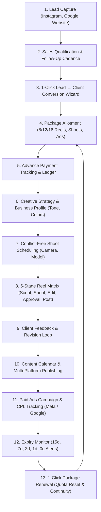

# SMARTERA DIGITAL — AGENCY OPERATIONS & CRM WORKFLOW MANUAL

> **Production-Grade Standard Operating Procedures (SOP) & Technical Architecture Documentation**  
> *Agency Lifecycle: Lead → Sales → Client → Package → Payment → Strategy → Shoot → Editing → Approval → Scheduling → Posting → Paid Ads → Expiry → Renewal*

---

## 📑 Table of Contents

1. [Executive Summary & Core Philosophy](#1-executive-summary--core-philosophy)
2. [The 13-Stage Master Agency Lifecycle](#2-the-13-stage-master-agency-lifecycle)
3. [Role-Based Access Control (RBAC) & Team Personas](#3-role-based-access-control-rbac--team-personas)
4. [Step-by-Step Operational Workflow Guides](#4-step-by-step-operational-workflow-guides)
   - [Workflow 1: Lead Capture, Qualification & Follow-Up](#workflow-1-lead-capture-qualification--follow-up)
   - [Workflow 2: 1-Click Lead → Client Conversion Wizard](#workflow-2-1-click-lead--client-conversion-wizard)
   - [Workflow 3: Creative Strategy & Client Business Profile](#workflow-3-creative-strategy--client-business-profile)
   - [Workflow 4: Conflict-Free Shoot Scheduling Engine](#workflow-4-conflict-free-shoot-scheduling-engine)
   - [Workflow 5: 5-Stage Granular Reel Matrix](#workflow-5-5-stage-granular-reel-matrix)
   - [Workflow 6: Client Review, Approval & Revisions](#workflow-6-client-review-approval--revisions)
   - [Workflow 7: Content Calendar & Publishing Coordination](#workflow-7-content-calendar--publishing-coordination)
   - [Workflow 8: Multi-Installment Payment Ledger & Accounting](#workflow-8-multi-installment-payment-ledger--accounting)
   - [Workflow 9: Paid Ads & Performance Marketing (Meta & Google)](#workflow-9-paid-ads--performance-marketing-meta--google)
   - [Workflow 10: 7-Day & 3-Day Expiry Engine & 1-Click Renewal](#workflow-10-7-day--3-day-expiry-engine--1-click-renewal)
   - [Workflow 11: 20-Question Executive Operations Intelligence](#workflow-11-20-question-executive-operations-intelligence)
5. [Database Architecture & PostgreSQL / Supabase Schema](#5-database-architecture--postgresql--supabase-schema)
6. [API Endpoints Reference](#6-api-endpoints-reference)
7. [System Administration & Troubleshooting](#7-system-administration--troubleshooting)

---

## 1. Executive Summary & Core Philosophy

**SMARTERA DIGITAL CRM** is a purpose-built agency management system specifically designed for modern digital marketing, video production, and performance marketing agencies.

### 🎯 Key Architectural Principle: Metadata & Workflow Tracking
* **What the CRM manages**: Deliverable deadlines, crew schedules, script approvals, video review links, ad budgets, staff assignments, invoices, payment balances, and contract renewal states.
* **What is managed outside the CRM**: Heavy raw footage, 4K camera files, Premiere Pro project files, and final MP4 assets (managed in Google Drive, Frame.io, or NAS). The CRM stores external URLs (e.g. `https://drive.google.com/...`) linked to each reel and shoot.

---

## 2. The 13-Stage Master Agency Lifecycle



---

## 3. Role-Based Access Control (RBAC) & Team Personas

The system enforces strict role-based separation of concerns across 8 distinct agency roles:

| Role | Primary Persona | Key Responsibilities | Visible Modules |
|---|---|---|---|
| **Super Admin** | Aarav Sharma | Agency owner, financial ledgers, staff rates, package templates, system audit logs. | All Modules + Settings |
| **Sales Person** | Priya Verma | Lead capture, qualification calls, proposals, lead conversion. | Leads, Follow-ups, Packages |
| **Social Media Manager** | Neha Gupta | Account lead, hook scripting, client business profile, approval coordination, content calendar. | Clients, Calendar, Reels, Tasks |
| **Camera Man** | Rahul Sen | Equipment DP, shoot execution, call times, location footage delivery. | Shoots, Calendar, Reels |
| **Video Editor** | Rohan Mehta | Retention editing, color grading, motion graphics, revision rounds. | Reels Matrix, Tasks, Calendar |
| **Model** | Simran Kaur | On-camera dialogue, outfit changes, shoot call time adherence. | Shoots, Calendar |
| **Ads Manager** | Vikram Malhotra | Meta & Google ad accounts, audience targeting, CPL optimization. | Campaigns, Clients, Reports |

---

## 4. Step-by-Step Operational Workflow Guides

---

### Workflow 1: Lead Capture, Qualification & Follow-Up

**URL**: [`http://localhost:5173/leads`](http://localhost:5173/leads)

1. **Capturing a Lead**:
   * Click **"+ Add New Lead"**.
   * Enter Company Name, Contact Person, Phone, WhatsApp, Category (Fashion, Real Estate, Healthcare, Dining, etc.), Source (Instagram, Google, Referral, Website), and Estimated Budget.
   * Assign a Sales Representative (*Priya Verma*).
2. **Follow-Up Cadence**:
   * Click on any lead to open the **Lead Details Drawer**.
   * Click **"+ Log Follow-up"** to schedule a Call, Meeting, WhatsApp message, or Email with a date and time.
   * When follow-up is completed, record outcome notes (*"Client requested custom quote for 12 reels"*).
3. **Status Pipeline Progression**:
   * Move status: `New` $\to$ `Contacted` $\to$ `Interested` $\to$ `Meeting Scheduled` $\to$ `Proposal Sent` $\to$ `Won`.

---

### Workflow 2: 1-Click Lead → Client Conversion Wizard

**URL**: Click green **"Convert to Client"** button on any Lead card.

1. **Triggering Conversion**:
   * When a lead agrees to start work, click **"Convert to Client"**.
2. **The 3-in-1 Onboarding Wizard**:
   * **Step A (Client Details)**: Auto-populates business name, phone, email, category, and assigns a dedicated Social Media Account Manager (*Neha Gupta*).
   * **Step B (Package Selection)**: Select an initial package template (*Starter Brand Growth*, *Pro Brand Scaling*, or *Elite Brand Domination*), adjust custom discounts if applicable.
   * **Step C (Initial Advance Payment)**: Enter advance payment amount (e.g. ₹25,000 via UPI/NEFT), transaction ID, and payment note.
3. **System Execution**:
   * Instantly creates a **Client Record** (`CLI-2001`).
   * Generates a **Client Business Profile** for creative briefing.
   * Activates the **Client Package** with deliverable quota (e.g. 12 Reels, 2 Shoots).
   * Records the **Payment Transaction** and updates the ledger.
   * Marks the original Lead as `Won (Converted)` and redirects to the **Client Dashboard**.

---

### Workflow 3: Creative Strategy & Client Business Profile

**URL**: [`http://localhost:5173/clients/:id`](http://localhost:5173/clients)

1. **Brand Identity Brief**:
   * Navigate to **Client Details $\to$ Business Profile** tab.
   * Input **Brand Colors (Hex)** (e.g. `#1A365D, #C5A880`), **Brand Tone** (*High-End Luxury, Energetic, Warm*), **Target Demographic**, and **Competitor Benchmarks**.
2. **Shooting & Content SOPs**:
   * Document client-specific instructions (e.g. *"Tuesday morning shoots before opening hours"*, *"ASMR sizzling audio focus"*).
3. **Deliverable Progress Board**:
   * Live visual meter tracking:
     $$\text{Progress} = \frac{\text{Posted Reels}}{\text{Total Quota Reels}} \times 100\%$$

---

### Workflow 4: Conflict-Free Shoot Scheduling Engine

**URL**: [`http://localhost:5173/shoots`](http://localhost:5173/shoots)

1. **Scheduling a Shoot**:
   * Click **"+ Schedule New Shoot"**.
   * Select Client, Shoot Date, Call Time (e.g. `10:00 AM - 02:00 PM`), Location, Shoot Type (On-Location, Studio, Drone), and Target Reels count.
   * Assign Crew: Camera Man (*Rahul Sen*), Model (*Simran Kaur*), Video Editor (*Rohan Mehta*).
2. **Double-Booking Collision Prevention Engine**:
   * If a selected cameraman or model already has an active shoot overlapping on that date/time, the system triggers a **Conflict Warning Dialog** highlighting the exact conflicting client and shoot time.
   * Prevents accidental crew overbooking.
3. **Calendar Sync**:
   * The shoot immediately shows up as an interactive card on the **[Content Calendar](http://localhost:5173/calendar)**.

---

### Workflow 5: 5-Stage Granular Reel Matrix

**URL**: [`http://localhost:5173/reels`](http://localhost:5173/reels)

Each individual reel undergoes discrete tracking across 5 operational dimensions:

| Dimension | Available Stages | Responsible Role |
|---|---|---|
| **1. Script Status** | `Not Started` $\to$ `In Progress` $\to$ `Ready` $\to$ `Completed` | Social Media Manager (Neha) |
| **2. Shoot Status** | `Not Required` $\to$ `Planned` $\to$ `Scheduled` $\to$ `Completed` | Camera Man (Rahul) |
| **3. Editing Status** | `Not Started` $\to$ `In Progress` $\to$ `Internal Review` $\to$ `Revision Required` $\to$ `Completed` | Video Editor (Rohan) |
| **4. Client Approval** | `Not Required` $\to$ `Pending` $\to$ `Approved` $\to$ `Changes Requested` | Client / Account Lead |
| **5. Posting Status** | `Not Scheduled` $\to$ `Scheduled` $\to$ `Posted` $\to$ `Cancelled` | Social Media Manager |

* **Overall Status Sync**: Automatically calculated (e.g. if editing is in progress, overall stage displays *Editing*).
* **External Review Link**: Paste the Google Drive / Frame.io video review URL into the reel card for one-click crew access.

---

### Workflow 6: Client Review, Approval & Revisions

1. When the editor completes a draft, update **Editing Status** to `Internal Review`.
2. SMM checks the reel and sets **Client Approval Status** to `Pending`.
3. **Handling Revisions**:
   * If the client requests modifications, select `Changes Requested`.
   * Add **Approval Notes** (e.g. *"Change soundtrack at 0:08 and speed up hook caption"*).
   * The reel automatically shifts editing status to `Revision Required` and notifies the editor.
4. When approved, set status to `Approved` and set the target **Posting Date & Time**.

---

### Workflow 7: Content Calendar & Publishing Coordination

**URL**: [`http://localhost:5173/calendar`](http://localhost:5173/calendar)

1. **Unified Agency View**:
   * Plots both **🎬 Shoots** and **📱 Scheduled Reels/Posts** on a visual monthly/weekly calendar.
2. **Client Filtering**:
   * Filter calendar by specific client to view that client’s release schedule.
3. **Publishing Execution**:
   * On the scheduled date and time, the SMM publishes the approved reel to Instagram/Facebook/LinkedIn and marks the posting status as `Posted`.
   * The Client’s deliverable meter and package quota usage automatically increment!

---

### Workflow 8: Multi-Installment Payment Ledger & Accounting

**URL**: [`http://localhost:5173/payments`](http://localhost:5173/payments)

1. **Recording Installments**:
   * Click **"+ Record Payment"**.
   * Select Client, Active Package, Amount, Payment Date, Method (Cash, UPI, Bank Transfer, Card), and Transaction ID.
2. **Automated Balance Calculation**:
   $$\text{Remaining Balance} = \text{Package Final Price} - \sum \text{Installments Paid}$$
3. **Automated Status Triggering**:
   * Total Paid = Final Price $\longrightarrow$ Status becomes **`Paid`**
   * Total Paid < Final Price $\longrightarrow$ Status becomes **`Partial`**
   * Total Paid = 0 $\longrightarrow$ Status becomes **`Pending`**
4. **Validation Guardrails**:
   * The system prevents entering payment amounts exceeding the remaining package balance.

---

### Workflow 9: Paid Ads & Performance Marketing (Meta & Google)

**URL**: [`http://localhost:5173/campaigns`](http://localhost:5173/campaigns)

1. **Creating Ad Campaigns**:
   * Click **"+ Create Campaign"**.
   * Select Client, Platform (*Meta Ads, Google Search, Google Performance Max, LinkedIn*), Start/End Dates, Objective, and Budget.
2. **Performance Monitoring & Cost Per Lead (CPL)**:
   * Track live metrics: Spend, Leads Generated, Impressions, Reach, Clicks, Conversions.
   * Auto-computed Cost Per Lead:
     $$\text{CPL} = \frac{\text{Spend}}{\text{Leads}}$$
3. **Pacing Controls**:
   * Identify campaigns exceeding target CPL benchmarks and switch status (*Running, Paused, Completed*).

---

### Workflow 10: 7-Day & 3-Day Expiry Engine & 1-Click Renewal

**URL**: [`http://localhost:5173/packages`](http://localhost:5173/packages)

1. **Automated Expiration Tracking**:
   * The system evaluates contract end dates daily:
     * **15 Days Out**: Standard renewal forecast.
     * **7 Days Out**: SMM & Sales rep receive **Warning Alert** to schedule renewal presentation.
     * **3 Days Out**: High-priority alert triggered.
     * **0 Days Out**: Package transitions to `Expired`.
2. **1-Click Package Renewal**:
   * Click **"Renew Package"** on the client package card.
   * Select renewal template, effective start date (auto-sets next 30 days), and price/discount.
   * **Result**:
     * Previous package archived in billing history.
     * New package activated with refreshed deliverable quotas (e.g. 0/12 Reels, 0/2 Shoots).
     * Historical shoots, reels, and invoices remain intact.

---

### Workflow 11: 20-Question Executive Operations Intelligence

**URL**: [`http://localhost:5173/reports`](http://localhost:5173/reports)

The Operations Intelligence engine delivers instant answers to key business metrics:

1. How many active clients are on retainer?
2. What is our total monthly recurring revenue (MRR)?
3. What is our collected revenue vs. outstanding unpaid receivables?
4. How many reels are currently in the editing queue?
5. How many shoots are scheduled for the next 7 days?
6. Which client packages are expiring within 7 days?
7. What is our blended agency Cost Per Lead (CPL) across all Meta/Google ad campaigns?
8. What is our lead-to-client conversion rate?
9. Which lead acquisition channels generate the highest revenue?
10. What is the workload distribution across video editors and cameramen?

---

## 5. Database Architecture & PostgreSQL / Supabase Schema

All CRM data is stored in a clean PostgreSQL schema with foreign keys, cascading deletions, and indexing.

### Core Tables Summary

| Table Name | Description | Key Foreign Keys |
|---|---|---|
| `profiles` | Staff, management & system users. | — |
| `staff_profiles` | Equipment, day rates, skills, and availability. | `user_id -> profiles(id)` |
| `leads` | Sales inquiries, pipeline stages, budgets, sources. | `assigned_sales_id -> profiles(id)` |
| `lead_followups` | Follow-up call, meeting, and outreach logs. | `lead_id -> leads(id)` |
| `clients` | Retainer businesses and brand accounts. | `lead_id -> leads(id), assigned_manager_id -> profiles(id)` |
| `client_business_profiles` | Brand colors, brand tone, instructions, audience. | `client_id -> clients(id)` |
| `package_templates` | Standard agency plans (Starter, Pro, Elite). | — |
| `client_packages` | Active client contracts, pricing, and dates. | `client_id -> clients(id), package_template_id -> package_templates(id)` |
| `package_usage` | Real-time deliverable quota counters. | `client_package_id -> client_packages(id)` |
| `payments` | Installment ledger and payment records. | `client_id -> clients(id), client_package_id -> client_packages(id)` |
| `shoots` | Video production shoots and crew bookings. | `client_id -> clients(id), cameraman_id -> profiles(id), model_id -> profiles(id)` |
| `reels` | 5-stage metadata tracking matrix for reels. | `client_id -> clients(id), assigned_editor_id -> profiles(id), shoot_id -> shoots(id)` |
| `campaigns` | Meta & Google ad budgets, spend, and CPL. | `client_id -> clients(id)` |
| `tasks` | Team task assignments and deadlines. | `client_id -> clients(id), assigned_to -> profiles(id)` |
| `notifications` | Role-based notifications and expiry alerts. | `user_id -> profiles(id)` |
| `activity_logs` | Immutable audit trail of critical actions. | `user_id -> profiles(id)` |

---

## 6. API Endpoints Reference

### Authentication & Profiles
* `POST /api/auth/login` — Authenticate and receive JWT token
* `GET  /api/auth/me` — Retrieve current authenticated session user
* `PUT  /api/auth/profile` — Update user profile

### Leads Pipeline
* `GET    /api/leads` — List leads (supports `status`, `salesId`, `search` filters)
* `GET    /api/leads/:id` — Get single lead details with follow-ups
* `POST   /api/leads` — Create new lead
* `PUT    /api/leads/:id` — Update lead details / status
* `DELETE /api/leads/:id` — Delete lead
* `POST   /api/leads/followups` — Log new follow-up
* `POST   /api/leads/convert` — Execute 1-Click Lead $\to$ Client conversion

### Clients & Business Profiles
* `GET    /api/clients` — List clients (supports `status`, `managerId`, `search`)
* `GET    /api/clients/:id` — Get full client dossier (packages, reels, payments)
* `POST   /api/clients` — Create client directly
* `PUT    /api/clients/:id` — Update client info
* `PUT    /api/clients/:id/business-profile` — Update brand colors, tone, strategy
* `GET    /api/clients/:id/work-board` — Fetch monthly deliverable completion stats

### Shoots & Conflict Engine
* `GET    /api/shoots` — List all production shoots
* `POST   /api/shoots/check-conflicts` — Check crew double-booking collisions
* `POST   /api/shoots` — Create shoot (with auto-conflict check)
* `PUT    /api/shoots/:id` — Update shoot details
* `DELETE /api/shoots/:id` — Cancel / remove shoot

### Reels Workflow Matrix
* `GET    /api/reels` — List reels (supports `clientId`, `editorId`, `status`)
* `POST   /api/reels` — Add new reel to workflow
* `PUT    /api/reels/:id` — Update script, shoot, edit, approval, or post status
* `DELETE /api/reels/:id` — Remove reel

### Packages & Payments
* `GET    /api/packages/templates` — List package templates
* `GET    /api/packages/client-packages` — List all client packages
* `POST   /api/packages/client-packages/:id/renew` — Execute 1-Click renewal
* `GET    /api/payments` — Get payment transactions ledger
* `POST   /api/payments` — Record installment payment

### Campaigns & Reports
* `GET    /api/campaigns` — List performance ad campaigns
* `POST   /api/campaigns` — Create new ad campaign
* `GET    /api/reports/dashboard` — High-speed executive dashboard metrics
* `GET    /api/reports/full` — Comprehensive 20-question operations intelligence report

---

## 7. System Administration & Troubleshooting

### Running the System Locally
```powershell
# Start both Backend API (Port 5000) and Frontend Client (Port 5173)
npm run dev
```

### Database Synchronization & Migration Commands
```powershell
# 1. Apply Schema Migrations to PostgreSQL / Supabase
npm run db:migrate

# 2. Seed Initial Demo Agency Records into Database
npm run db:seed
```

### Verification & Automated Test Suite
```powershell
# Run the 21-point automated business logic test suite
npx tsx test_system.ts
```

---

*Documentation Version: 1.0.0 (Production Release)*  
*System Architecture: Smartera Digital Agency CRM*
